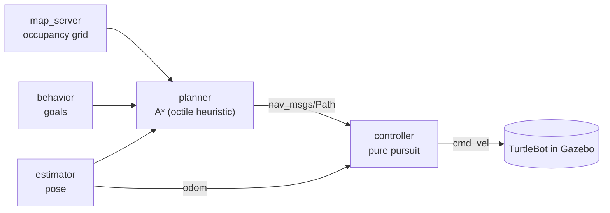

# Robotic System Design: ROS 2 navigation

**A mobile robot that plans its own path and follows it, in ROS 2.** 
The navigation stack for a simulated TurtleBot: an A\* global planner on an occupancy grid and a
pure-pursuit controller that drives the robot along the path, wired together with ROS 2 topics and
launch files. For NUS EE3305/ME3243 *Robotic System Design*.

> [!NOTE]
> This consolidated README page was added by
> [Claude Opus 5.5](https://docs.anthropic.com/en/docs/claude-code) in Nov 2026 using my
> [agentic-repo-analysis](https://github.com/sp4ce-cowboy/agentic-workflows) skill, from the
> project's code and the team's report. The project itself is from Oct – Nov 2024. The previous
> README was a placeholder. The technical write-up is in **[ARCHITECTURE.md](ARCHITECTURE.md)**.

## At a glance

| | |
|---|---|
| **What** | Autonomous navigation for a differential-drive robot: localise on a map, plan a path to a goal with A\*, and follow it with pure pursuit |
| **Context** | NUS [EE3305/ME3243](https://nusmods.com/courses/ME3243/robotic-system-design) *Robotic System Design*, AY2024/25 Semester 1, Part 2 project (Oct – Nov 2024) |
| **Team** | Neo Siao Bee Dawn, Asahi Sugano and Rubesh Suresh |
| **My role** | The pure-pursuit controller node ([my slides](docs/controller-slides.pdf)) |
| **Report** | [The team's report](docs/team14-report.pdf) (13 pages; matriculation numbers redacted) |
| **Stack** | ROS 2 (rclcpp, nav_msgs, geometry_msgs), C++, Gazebo, RViz, launch files and YAML parameters |

## How it works

- **Planner:** A\* over the occupancy grid with an octile-distance heuristic for diagonal moves, a
  priority queue by f = g + h, a visited grid, boundary checks, early exit when no path exists, and
  cleanup of the search's nodes ([`run`](https://github.com/sp4ce-cowboy/robotic-system-design/blob/54daac50e1fe1d8af0c7f0010ea4dc71b6893996/src/ee3305_nav/src/planner.cpp#L175-L260)).
- **Controller:** finds the lookahead point on the path, transforms it into the robot's frame, turns
  it into a curvature and an angular velocity, limits velocity and acceleration, and stops within a
  threshold of the goal ([`cbTimerMain`](https://github.com/sp4ce-cowboy/robotic-system-design/blob/54daac50e1fe1d8af0c7f0010ea4dc71b6893996/src/ee3305_nav/src/controller.cpp#L139-L300)).
- **Integration:** one launch file brings up the map, nodes, Gazebo and RViz, with parameters in
  YAML; the path topic uses sensor-data QoS so the controller always acts on the newest plan.

## Skills shown

| Skill | Where it shows (click the links for the code) | Docs |
|---|---|---|
| **Path tracking control**  | Pure pursuit: lookahead search, curvature to angular velocity, acceleration and velocity limits, goal threshold: [`controller.cpp`](https://github.com/sp4ce-cowboy/robotic-system-design/blob/54daac50e1fe1d8af0c7f0010ea4dc71b6893996/src/ee3305_nav/src/controller.cpp#L139-L300) | [rclcpp](https://docs.ros.org/en/humble/p/rclcpp/) |
| **Path planning** | A\* with an octile heuristic and a priority queue: [`planner.cpp`](https://github.com/sp4ce-cowboy/robotic-system-design/blob/54daac50e1fe1d8af0c7f0010ea4dc71b6893996/src/ee3305_nav/src/planner.cpp#L175-L260) | [Nav2 concepts](https://docs.nav2.org/concepts/index.html) |
| **ROS 2 systems** | Topics, timers and callbacks; launch files and YAML parameters: [`project.launch.py`](https://github.com/sp4ce-cowboy/robotic-system-design/blob/54daac50e1fe1d8af0c7f0010ea4dc71b6893996/src/ee3305_bringup/launch/project.launch.py), [`project.yaml`](https://github.com/sp4ce-cowboy/robotic-system-design/blob/54daac50e1fe1d8af0c7f0010ea4dc71b6893996/src/ee3305_bringup/params/project.yaml) | [ROS 2 launch](https://docs.ros.org/en/humble/Tutorials/Intermediate/Launch/Launch-Main.html) |
| **C++** | Modern C++ in ROS nodes: lambdas, `std::priority_queue`, smart parameter handling | [cppreference](https://en.cppreference.com) |

## On my resume

**Skills:** ROS 2 · C++ · path planning (A\*) · path tracking (pure pursuit) · Gazebo · RViz · robot navigation

- Built the pure-pursuit controller of a ROS 2 navigation stack in C++: lookahead-point search on the planned path, transformation into the robot frame, curvature-based angular velocity, velocity and acceleration limits, and a goal-stopping threshold, publishing `cmd_vel` to a simulated TurtleBot.
- Integrated the controller with a team-built A\* planner (octile heuristic, priority queue) through ROS 2 topics with sensor-data QoS, launch files and YAML parameters, validated in Gazebo and RViz.

## Getting started

In a ROS 2 workspace: `colcon build`, then `ros2 launch ee3305_bringup project.launch.py`.
